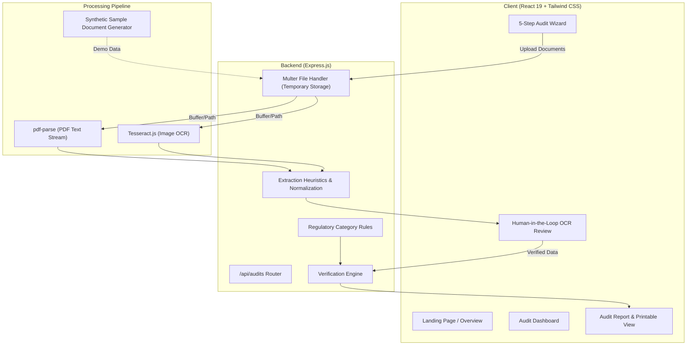
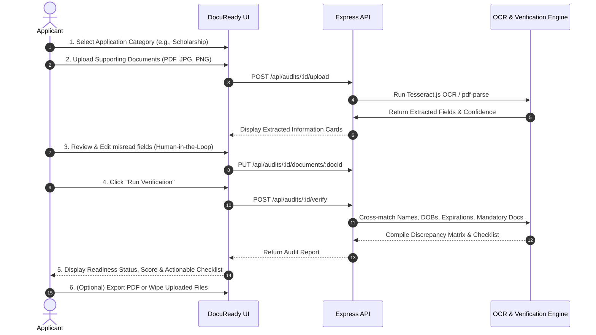

# DocuReady

> **Catch application-ending errors before you click submit.**

[](LICENSE)
[](https://nodejs.org/)
[](https://react.dev/)
[](https://tailwindcss.com/)
[](https://github.com/naptha/tesseract.js)

An intelligent pre-submission application auditing platform that extracts, cross-checks and validates supporting documents to identify potential errors before official submission.

---

## 📌 Problem Statement

Every year, thousands of qualified applicants applying for **merit-cum-means scholarships**, **university and college admissions**, and **government welfare or Direct Benefit Transfer (DBT) schemes** face immediate rejection or administrative delays due to preventable document discrepancies:

- **Inconsistent Names & Initials:** Discrepancies between official identity records (e.g. Aadhaar / National ID) and academic certificates (e.g. middle initial abbreviations like *"Rahul S. Sharma"* vs *"Rahul Sharma"*).
- **Date of Birth (DOB) Mismatches:** Discrepancies in birth years or dates across certificates (e.g. `12/05/2005` in high school records vs `12/05/2004` on a local revenue income certificate).
- **Missing Mandatory Documents:** Inadvertently submitting an incomplete application packet lacking required declarations, marksheets, or application summaries.
- **Expired or Stale Certificates:** Submitting income or community certificates that exceed the mandated regulatory validity threshold (e.g. certificates older than 1 financial year).
- **Unreadable Scans & Incompatible Formats:** Submitting corrupted PDFs, low-resolution blurry scans, or unreadable document images that automated portal filters reject outright.

---

## 💡 Proposed Solution

**DocuReady** serves as an intelligent, advisory pre-flight audit system. Before an applicant clicks *Submit* on an institutional or government portal, DocuReady analyzes their application packet as a holistic unit.

It extracts key metadata using local optical character recognition (OCR) and PDF parsing, runs multi-entity cross-document validation algorithms, checks compliance against program-specific rules, and produces an actionable, prioritized audit report with an application readiness score.

---

## ✨ Key Features

### 1. Multi-Document Ingestion & Validation
- Supports PDF, JPG, and PNG documents.
- Accepts multiple simultaneous uploads mapped to standard document categories (*Application Form*, *Identity Proof*, *Marksheet*, *Income Certificate*, *Caste Certificate*).
- Real-time client- and server-side file type and size constraints (enforcing standard ≤ 10MB portal limits).

### 2. OCR Information Extraction
- Integrates **Tesseract.js** for browser- and server-grade optical character recognition on scanned images.
- High-efficiency PDF text stream parsing via **pdf-parse**.
- Intelligent heuristics extract Candidate Legal Name, Date of Birth (DOB), Document/Roll Number, Issue Date, Expiry Date, Issuing Authority, and academic/financial metrics.
- Distinguishes unreadable or blurry scans from valid documents, reporting explicit reasons without hallucinating or inventing missing information.
- Provides a human-in-the-loop review interface allowing applicants to correct any misread OCR text before verification.

### 3. Cross-Document Consistency Verification
- **Smart Name Normalization:** Normalizes whitespace, casing, punctuation, and titles/honorifics (*Mr., Ms., Shri, Smt., Dr., Kumari*).
- **Context-Aware Initial Handling:** Differentiates minor variations (e.g. single-letter middle initials like *"Rahul S. Sharma"* vs *"Rahul Sharma"*) from critical mismatches, categorizing them as advisory warnings rather than false-positive fatal errors.
- **Strict Date of Birth Cross-Matching:** Cross-checks DOBs across all submitted records, catching year mismatches and DD/MM vs MM/DD formatting ambiguities.
- **Side-by-Side Source Attribution:** Visually displays the conflicting documents and extracted values side-by-side for full transparency.

### 4. Missing Document Detection
- Maintains configurable rule requirements for individual application categories (*Scholarship*, *College Admission*, *Government Scheme*).
- Categorizes each required document type and flags any missing mandatory files.
- Strictly separates a *missing* document from an *unreadable* document.

### 5. Certificate Validity & Freshness Checks
- Compares stated certificate expiration dates against the active evaluation timeline.
- Enforces validity constraints (e.g. Income Certificates must be issued within 1 year for scholarship schemes).

### 6. Comprehensive Audit Report & Action Checklist
- Assigns an overall application readiness status:
  - `READY FOR REVIEW`: All mandatory files present; 0 blocking discrepancies.
  - `NEEDS ATTENTION`: Documents present; advisory warnings (e.g. initial variations, impending certificate expirations).
  - `INCOMPLETE`: Blocking issues present (missing mandatory files, unreadable scans, or severe DOB mismatches).
- Computes an Application Health Index (0 - 100%).
- Generates an actionable, prioritized checklist (High Priority vs Medium Priority) guiding the applicant on exact corrective measures.
- Native browser print/PDF export formatting (`window.print()`).
- Prominent advisory disclaimer: Never guarantees official acceptance or replaces statutory authority.

---

## 🛠️ Technology Stack

| Layer | Technologies |
|---|---|
| **Frontend** | React 19, Vite, Tailwind CSS v4, Lucide React Icons |
| **Backend** | Node.js (v18+ / v24), Express.js, Multer |
| **Document Processing** | Tesseract.js (OCR), pdf-parse (PDF extraction) |
| **Development Tooling** | Concurrently, Oxlint, ES Modules |

---

## 🏗️ System Architecture



---

## 🔄 Complete Application Workflow



---

## 📸 Screenshots

*(Placeholders for application interface captures)*

### 1. Landing Page & Category Selection
```
+-----------------------------------------------------------------------------------+
|  DocuReady [MVP]                       Overview   Dashboard   Demo   [New Audit]  |
|                                                                                   |
|            Catch application-ending errors before you click submit.               |
|                                                                                   |
|      [ Scholarship ]             [ College Admission ]      [ Government Scheme ] |
+-----------------------------------------------------------------------------------+
```
> *Placeholder: Add screenshot of the landing page and application category selection screen here (`docs/screenshots/01-landing-page.png`).*

### 2. OCR Extraction & Human-in-the-Loop Review
```
+-----------------------------------------------------------------------------------+
|  Step 3: Review Extracted Information                         OCR Confidence: 94% |
|                                                                                   |
|  Candidate Name: [ Rahul S. Sharma ]       Date of Birth: [ 12/05/2005 ]         |
|  Document Number: [ CBSE-2023-884120 ]     Issuing Body:  [ CBSE Board ]         |
|  [ View Raw OCR Text Stream ]              [ Edit Fields ]  [ Save & Confirm ]   |
+-----------------------------------------------------------------------------------+
```
> *Placeholder: Add screenshot of the OCR review and inline editing interface here (`docs/screenshots/02-ocr-review.png`).*

### 3. Cross-Document Discrepancy Matrix
```
+-----------------------------------------------------------------------------------+
|  CRITICAL DATE_OF_BIRTH                                                           |
|  Source A: Aadhaar Card (12/05/2005)  <--->  Source B: Income Cert (12/05/2004)   |
|  Recommendation: Correct birth year discrepancy with issuing revenue authority.   |
|                                                                                   |
|  WARNING CANDIDATE_NAME                                                           |
|  Source A: Aadhaar Card (Rahul Sharma) <---> Source B: Marksheet (Rahul S. Sharma)|
|  Recommendation: Middle initial 'S.' detected. Verify institution initial policy. |
+-----------------------------------------------------------------------------------+
```
> *Placeholder: Add screenshot of the cross-document discrepancy matrix here (`docs/screenshots/03-discrepancy-matrix.png`).*

### 4. Comprehensive Audit Report & Action Checklist
```
+-----------------------------------------------------------------------------------+
|  Application Status: INCOMPLETE                             Readiness Score: 15% |
|  [HIGH PRIORITY] Upload official Scholarship Application Form before submitting.  |
|  [HIGH PRIORITY] Resolve DOB year conflict (2005 vs 2004) before submission.      |
|  [MEDIUM] Check institution rules for middle initial expansion.                   |
|                                                                                   |
|  [ Print / Save PDF Report ]                  [ Delete Audit & Permanently Wipe ] |
+-----------------------------------------------------------------------------------+
```
> *Placeholder: Add screenshot of the final printable audit report here (`docs/screenshots/04-audit-report.png`).*

---

## 🧪 Synthetic Demonstration Data

To verify the audit workflow without requiring personal documents, DocuReady includes a built-in synthetic benchmark case:

- **Target Category:** Merit-cum-Means Scholarship
- **Applicant Profile:** Rahul Sharma
- **Synthetic Documents Included:**
  1. `Synthetic_Aadhaar_Rahul_Sharma.pdf` (Identity Proof: *Rahul Sharma*, DOB `12/05/2005`)
  2. `Synthetic_Class_XII_Marksheet_Rahul.pdf` (Marksheet: *Rahul S. Sharma*, DOB `12/05/2005`, Score `88.4%`)
  3. `Synthetic_Income_Certificate_Rahul.pdf` (Income Certificate: *Rahul Sharma*, DOB `12/05/2004`, Issued `14/08/2023`)
  4. *Application Form:* Intentionally omitted to test missing document detection.
- **Expected Verification Outcomes:**
  - Name variation correctly detected as a **Warning** (middle initial `S.` present in Marksheet but absent in Aadhaar; not flagged as a fatal error).
  - Date of birth mismatch correctly flagged as **Critical** (`2005` vs `2004`).
  - Income certificate flagged as **Expired / Stale** (> 1 year old).
  - Missing mandatory Scholarship Application Form flagged as **Required**.
  - Overall status flagged as **`INCOMPLETE`** with prioritized recommendations.

> **Note:** All sample documents are synthetic benchmark records generated strictly for testing. They contain no real personal identifiable information.

---

## 🔒 Privacy & Security Considerations

- **Zero-Retention Ephemeral Processing:** Documents uploaded during an audit session are stored temporarily in a segregated local directory.
- **One-Click Data Purge:** Every audit report features a **"Delete & Wipe Files"** button that permanently removes all uploaded files from disk and purges the session from memory via `DELETE /api/audits/:id`.
- **No External Paid AI / Cloud API Dependency:** All document parsing (pdf-parse) and character recognition (Tesseract.js) execute within your local environment. Document contents are never sent to external AI providers.
- **Non-Guarantee Advisory Notice:** In compliance with ethical application pre-auditing standards, DocuReady displays clear disclaimers that pre-submission checks are advisory and do not replace discretionary institutional authority.

---

## 💻 Installation & Local Setup

### Prerequisites
- [Node.js](https://nodejs.org/) (v18.0.0 or higher; tested on v24)
- npm (v9.0.0 or higher)
- Git

### 1. Clone the Repository
```bash
git clone https://github.com/dhruv10-06/DocuReady.git
cd DocuReady
```

### 2. Install Dependencies
```bash
# Install root dependencies (concurrently)
npm install

# Install server dependencies
cd server && npm install && cd ..

# Install client dependencies
cd client && npm install && cd ..
```

### 3. Configure Environment Variables (Optional)
Copy the example environment configuration:
```bash
cp .env.example .env
```
*(Default settings use PORT=5000 for backend and PORT=5173 for frontend proxy).*

### 4. Run the Development Server
Start both backend API and frontend Vite hot-reload server simultaneously:
```bash
npm run dev
```
- **Frontend Application:** [http://localhost:5173](http://localhost:5173)
- **Backend API Server:** [http://localhost:5000](http://localhost:5000)

### 5. Run Automated Tests
Execute the verification engine automated test suite:
```bash
npm test
```
All 6 core tests (category verification, initial variation logic, DOB mismatch detection, benchmark audit execution, PDF extraction, and unreadable scan handling) run with 100% assertion pass rates.

---

## 🚀 Future Enhancements

- [ ] **Multi-Language OCR:** Extend Tesseract.js language packs to support regional Indian languages (Hindi, Marathi, Tamil, Telugu, Bengali) on state domicile certificates.
- [ ] **Digital Signature & QR Code Verification:** Decode cryptographically signed QR codes on government-issued e-Aadhaar and Digilocker certificates.
- [ ] **DigiLocker Integration:** Direct OAuth import of verified certificates from government DigiLocker accounts.
- [ ] **Application Form Auto-Fill:** Export verified metadata into standard format JSON or PDF to automatically populate application portals.
- [ ] **Export to CSV / Excel:** Allow educational institutions and NGOs managing bulk applicant cohorts to batch-audit candidate document sets.

---

## 📄 License

This project is licensed under the [MIT License](LICENSE).
